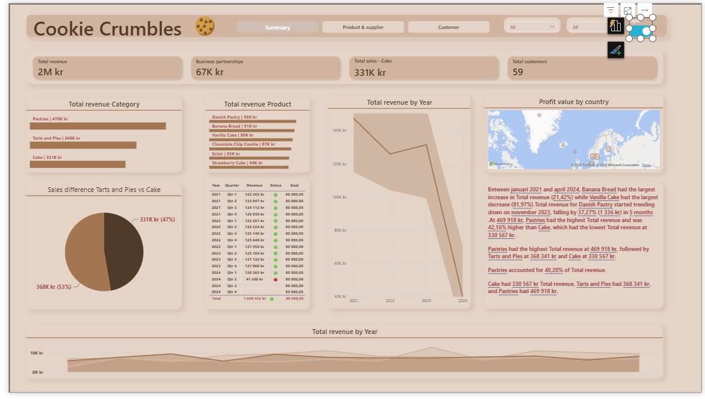
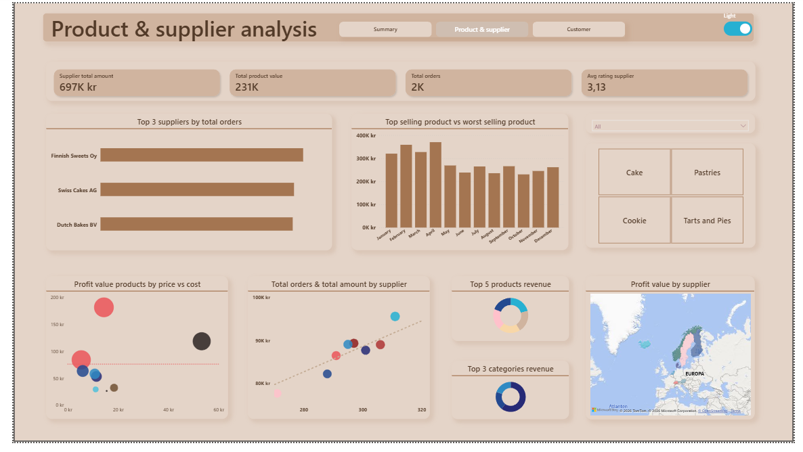
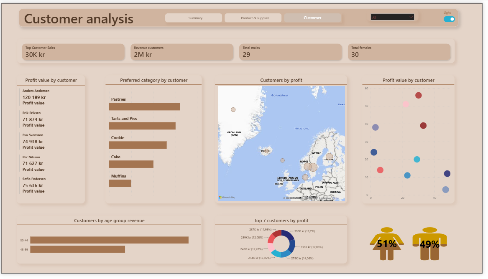
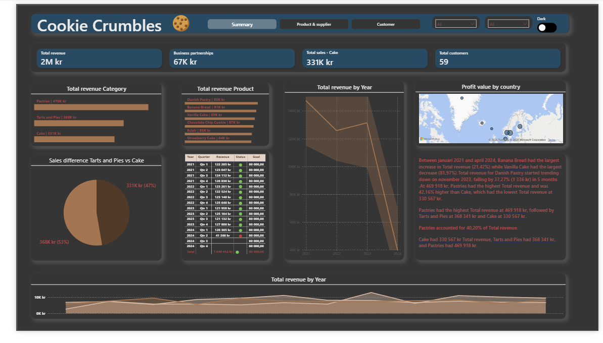

# Cookie Crumbles – Power BI Sales Dashboard

An end-to-end BI project for a fictional bakery that sells cakes, tarts, pies and cookies across Europe. I designed the database in SQL Server, built the data model in Power BI and created a three-page interactive report for sales, products and suppliers, and customers.

Exam project in Data Visualization, Data Engineer programme at Stockholms Tekniska Institut (2024).

## Dashboards

### Summary
Total revenue against goal, profit, sales by category and country, the Business Partnerships sales channel, and revenue trends by year, quarter and month.



### Product & supplier
Top and worst selling products, product price versus cost, supplier order amounts, average supplier rating, orders per year and suppliers by country.



### Customer
Total customers, revenue per customer, top customers, gender and age groups, preferred categories by customer segment, and customers by country.



### Light and dark theme
A toggle in the top right corner switches every page between a light and a dark theme. Colours are driven by DAX measures, so all visuals follow the selected theme.



## What I built

- **Database design.** Conceptual, logical and physical models in draw.io, implemented in SQL Server with bridge tables to resolve many-to-many relationships (`CookieCrumbles.sql`, `01Databas/`).
- **Data model.** Star-style model in Power BI with sales, orders, products, categories, suppliers, customers, segments and countries. Active and inactive relationships were tuned so that every supplier shows up in the right context.
- **DAX measures.** Organised in dedicated measure tables and display folders by area: sales, products, suppliers, customers and categories. They include revenue against goal with a status indicator, profit, revenue per customer, and top and worst selling product.
- **Report design.** One key indicator per page to avoid information overload, page navigation, slicers for year, category and country, maps, and a toggle that switches between light and dark theme.

### Example DAX

```dax
Top Selling Product =
VAR MaxSales = MAXX ( ALL ( 'Product' ), [Total Sales] )
RETURN
    CALCULATE (
        MAX ( 'Product'[ProductName] ),
        FILTER ( ALL ( 'Product' ), [Total Sales] = MaxSales )
    )
```

## Repository structure

| Folder | Contents |
| --- | --- |
| `02PowerBI/` | Power BI reports (`.pbix`), including the final Cookie Crumbles report |
| `01Databas/` | SQL scripts for creating and querying the databases |
| `04DrawIO/` | Database diagrams |
| `05Word/` | Project notes and the analysis questions behind the dashboards |
| `Bilder/` | Icons and images used in the report |

The final report is `CookieCrumbles.pbix` in the root folder. Open it with [Power BI Desktop](https://www.microsoft.com/power-platform/products/power-bi/desktop) (free, Windows).

## Tools

SQL Server · T-SQL · Power BI Desktop · DAX · draw.io

## Contact

Kristofer Fangrat · [GitHub](https://github.com/KristoferFangrat) · kristofer.fangrat@icloud.com
